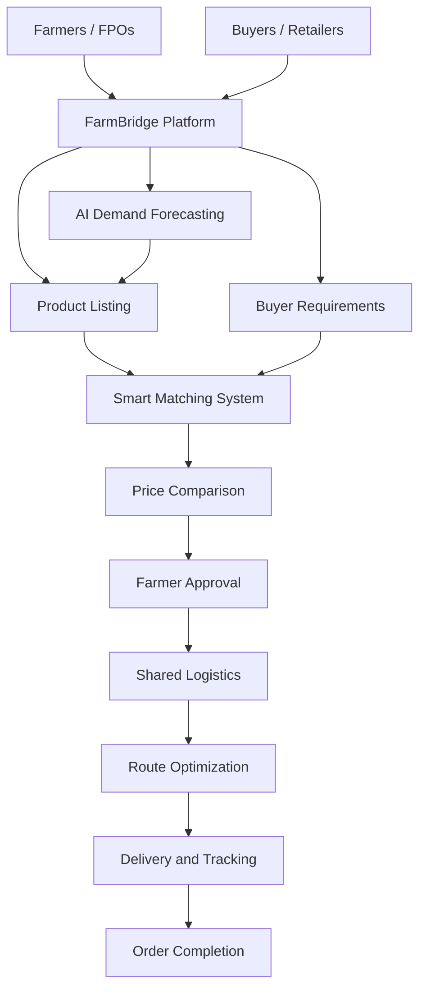

# Smart India Hackathon 2026

**Date:** 22 November 2026
---
**Reference Number:** 26015785
---
**Name:** Sugavarman K P
---
## Problem Title

**SIH 26033: Multiple intermediaries reduce farmers' earnings and increase consumer prices.**

## Problem Creator's Organization

Ministry of Consumer Affairs, Food & Public Distribution

## Theme

Agriculture, FoodTech & Rural Development

## Problem Description

Farmers often depend on multiple intermediaries to sell their agricultural products. This reduces their profit and increases the final price paid by consumers.

Small farmers also face difficulties in finding buyers, transporting products, and getting fair prices.

The main objective is to create a digital marketplace that:

- Connects farmers and Farmer Producer Organisations (FPOs) directly with buyers.
- Provides affordable logistics and transportation.
- Uses AI-based demand forecasting.
- Optimizes delivery routes.
- Improves transparency in agricultural trading.

## Proposed Solution – FarmBridge

FarmBridge is a digital agricultural marketplace designed to connect farmers, FPOs, retailers, restaurants, and bulk buyers.

It helps farmers find suitable buyers, compare offers, and reduce unnecessary supply-chain costs.

### How FarmBridge Works

1. **Farmer Registration:** Farmers and FPOs register and upload their crop details, quantity, quality, and expected price.
2. **Product Verification:** FPO operators verify the quantity and quality of agricultural products.
3. **Buyer Connection:** Retailers, restaurants, hostels, and other buyers post their requirements.
4. **Smart Matching:** FarmBridge identifies suitable buyers based on crop type, quantity, location, and delivery requirements.
5. **Price Comparison:** Farmers can compare offers and view transportation and handling charges.
6. **Shared Logistics:** The system combines nearby orders to reduce transportation expenses.
7. **Order Tracking:** Farmers and buyers can track orders and confirm delivery and payment records.

### How It Solves the Problem

- Reduces unnecessary intermediaries.
- Helps farmers receive better returns.
- Provides transparent pricing.
- Connects farmers directly with bulk buyers.
- Reduces transportation costs through shared delivery.
- Helps consumers access agricultural products at competitive prices.

### Innovation and Uniqueness

FarmBridge introduces a **Net Farmer Return Ranking System**.

Instead of displaying only the highest selling price, it calculates the estimated amount a farmer receives after transportation, packaging, handling, and other charges.

It also supports small-farmer product pooling, allowing multiple farmers to combine their products to fulfil larger buyer requirements.

The final selling decision always remains with the farmer or FPO.

## Technical Approach

### Technologies to Be Used

| Component | Technology |
|---|---|
| Frontend | HTML, CSS, JavaScript, React |
| Backend | Python, FastAPI |
| Database | PostgreSQL |
| Location Services | PostGIS, Maps API |
| AI/ML | Python, Scikit-learn |
| Route Optimization | Google OR-Tools |
| Communication | SMS / Notifications |
| Hosting | Cloud Hosting |

### System Architecture

### Implementation Methodology

**Phase 1 – User Registration**

Develop registration and login facilities for farmers, FPOs, and buyers.

**Phase 2 – Product Management**

Allow farmers to upload crop details, quantity, quality, images, and expected prices.

**Phase 3 – Smart Buyer Matching**

Match agricultural products with suitable buyers based on their requirements.

**Phase 4 – AI-Based Demand Forecasting**

Analyse previous orders and seasonal demand to estimate future crop requirements.

**Phase 5 – Logistics Optimization**

Use route optimization to combine nearby deliveries and reduce transportation costs.

**Phase 6 – Order Management**

Provide order tracking, delivery confirmation, and transaction records.

## Feasibility and Viability

### Feasibility of the Idea

FarmBridge can be developed using existing web technologies, smartphones, and cloud-based services.

The initial implementation can focus on a small geographical area with a few FPOs, farmers, and local buyers.

It does not require farmers to purchase expensive hardware.

### Potential Challenges

1. Limited internet connectivity in rural areas.
2. Lack of digital awareness among some farmers.
3. Differences in product quality and quantity.
4. Transportation and delivery difficulties.
5. Seasonal changes in agricultural demand.
6. Trust and payment-related issues.

### Solutions to Overcome Challenges

- Provide Tamil and other regional language support.
- Develop a mobile-friendly and low-bandwidth interface.
- Allow FPO operators to assist farmers.
- Introduce product quality verification.
- Use shared transportation facilities.
- Maintain transparent order and payment records.

### Sustainability

The platform can initially operate through FPO partnerships, institutional buyer subscriptions, or pilot project funding.

Future expansion can include additional crops, districts, and logistics partners.

## Impact and Benefits

### Benefits to Farmers

- Better price visibility.
- Improved bargaining opportunities.
- Direct access to bulk buyers.
- Reduced transportation expenses.
- Better control over selling decisions.

### Benefits to Consumers

- Competitive product prices.
- Better access to locally sourced produce.
- Improved product availability.
- More transparent purchasing.

### Economic Benefits

- Reduced avoidable supply-chain costs.
- Improved farmer income opportunities.
- Better market connections.
- Efficient agricultural distribution.

### Environmental Benefits

- Reduced unnecessary transportation.
- Better vehicle utilization.
- Potential reduction in food wastage.
- Improved delivery planning.

### Expected Impact Measurement

The pilot project will measure:

- Average farmer earnings per kilogram.
- Transportation cost per kilogram.
- Time taken to complete an order.
- Percentage of successful deliveries.
- Buyer satisfaction.
- Reduction in avoidable logistics expenses.

These results will be evaluated using actual pilot data.

## Research and References

1. Smart India Hackathon 2026 – Problem Statement 26033: https://github.com/selvasachein/SIH-26033
2. e-NAM – National Agriculture Market: https://www.enam.gov.in/
3. Department of Consumer Affairs: https://consumeraffairs.gov.in/
4. Small Farmers' Agribusiness Consortium (SFAC): https://sfacindia.com/
5. Google OR-Tools – Route Optimization: https://developers.google.com/optimization

---

**Project Name: FarmBridge**

**Tagline: Connecting Farmers Directly to Fair Markets.**
