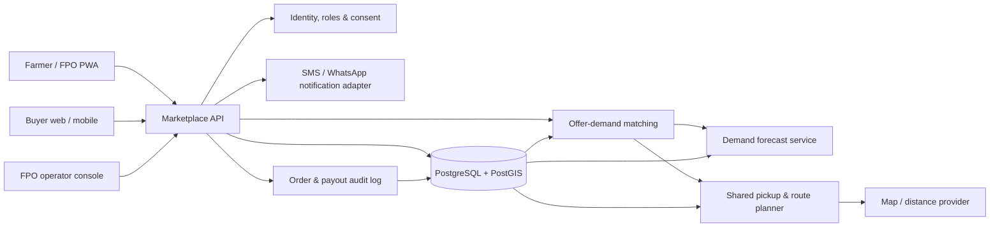

# FarmBridge: Fair-Price Produce Matching and Shared Logistics

**SIH 26033 | Agriculture, FoodTech & Rural Development**  
**Prepared for:** SIH Problem Statement Workshop  
**Problem:** Multiple intermediaries reduce farmers' earnings and increase consumer prices.

**Reference number:** 26015785  
**Team / applicant name:** Sugavarman K P  
**Prepared on:** 22 November 2026

## Executive summary

FarmBridge is a mobile-first marketplace and shared-logistics coordinator for Farmer Producer Organisations (FPOs), farmer groups, local retailers, institutional kitchens, and nearby consumers. It helps small producer groups combine compatible harvest lots, find quantity-backed local demand, and coordinate collection and delivery. Before accepting an order, the FPO sees the expected farmer payout after itemised packing, handling, and transport costs. This makes the net return visible while leaving the sale decision with the farmer or FPO.

The first pilot is deliberately narrow: one district, a few perishable crops, two or three FPOs, fixed collection points, and nearby repeat buyers. The demonstrator uses clearly labelled synthetic listings and orders. It shows eligibility-based matching, a transparent net-return comparison, and a capacity- and time-window-aware pooled route. Demand forecasting starts with a simple, explainable baseline and is presented with uncertainty; it is not used to promise demand or commit produce for sale.

### SIH requirement alignment

| SIH requirement | FarmBridge response | Pilot evidence |
|---|---|---|
| Connect farmers/FPOs with consumers and bulk buyers | FPO lot listings and buyer requests for quantity, grade, delivery area, and date | A buyer request matched to one or more compatible lots |
| Provide logistics support | Shared collection and delivery planning with capacity, distance, and time-window constraints | A route suggestion with estimated distance and per-order cost |
| Use AI for demand forecasting | Start with a seasonal moving-average baseline; evaluate a tree-based model only when sufficient clean order history exists | Forecast, confidence range, data coverage, and a clear baseline comparison |
| Optimize routes | Batch accepted orders and suggest feasible multi-stop routes; require operator confirmation | Before/after route distance and estimated transport cost for the same orders |
| Improve farmer and consumer outcomes | Show itemised delivered cost and expected net farmer payout before acceptance | Pilot metrics compared with the same FPO's usual channel, with sample sizes |

## 1. Proposed solution

FarmBridge is a mobile-first marketplace and fulfilment coordinator for Farmer Producer Organisations (FPOs), farmer groups, local retailers, institutional kitchens, and nearby consumers. It helps a farmer group combine small harvest lots, show buyers a transparent landed-price breakdown, and coordinate a shared pickup or delivery.

FarmBridge focuses on the gap between listing produce and completing a dependable sale. A listing includes crop, quantity, harvest window, village or collection point, grade, photos, and a minimum acceptable farm-gate price. Buyers place quantity-backed requests. The system matches compatible offers and requests within a practical distance, then presents the farmer group with the net amount after visible packing, handling, and transport costs. The FPO confirms the sale and settlement; the platform does not silently set a farm price.

### Main workflow

1. A farmer or FPO creates a produce lot by voice-assisted form, local-language text, or assisted entry by an FPO operator.
2. The FPO weighs and grades the lot at a collection point and records evidence such as a photo and weigh slip.
3. Nearby retailers, hostels, restaurants, and consumer groups post demand with quantity, delivery area, and date.
4. FarmBridge ranks feasible matches by net farmer return, freshness window, distance, and buyer reliability. The farmer/FPO sees the itemised offer before accepting.
5. The logistics planner groups accepted orders into vehicle routes, suggests collection times, and estimates cost per order.
6. Both parties receive a digital order record, delivery status, and settlement status. Disputes can be raised against the lot and delivery record.

### What makes it distinct

- **Net-return-first matching:** compare buyer offers after estimated logistics and handling costs, instead of ranking only by headline price.
- **Small-lot pooling:** group compatible nearby lots and buyer demand while keeping each farmer's quantity and payout traceable.
- **Open-book cost card:** show price, grade, quantity, packing, transport, platform fee (if any), and expected farmer payout before acceptance.
- **No forced auction:** allow FPOs to set a reserve price and accept, reject, or wait; the system recommends and explains matches but does not decide on behalf of the farmer.
- **Works with existing market channels:** begin as a coordination layer for FPOs and buyers. Any future connection to e-NAM or government price feeds requires approved access and should not duplicate their market functions.

## 2. How the solution addresses the problem

The problem is not solved by removing every intermediary: aggregation, grading, storage, transport, and risk-bearing are real services. FarmBridge makes those services visible and contestable. FPO aggregation gives small producers enough volume to approach larger buyers. Direct demand matching can shorten avoidable trading hops. Shared transport reduces per-unit delivery costs when compatible orders can be consolidated. A transparent payout record helps farmers compare the actual net return with alternative channels.

Consumers and institutional buyers can compare local supply, grade, and delivery cost in one place. Demand history helps FPOs plan harvest and collection windows. Unsold or unmatched produce remains visible to the FPO so it can choose another buyer or existing market channel rather than being represented as sold.

## 3. Technical approach

### Architecture

### Suggested implementation stack

- **Client:** React PWA with responsive English/Tamil interface; offline draft listings and queued sync for weak connectivity.
- **API:** Python FastAPI or Django REST Framework with role-based permissions and input validation.
- **Storage:** PostgreSQL with PostGIS for lots, demand, service areas, and distance queries; object storage for produce photos and delivery evidence.
- **Matching:** deterministic eligibility filters first (crop, date, quantity, distance, grade), followed by a transparent score weighted toward net farmer return and buyer reliability.
- **Forecasting:** start with a seasonal moving-average baseline by crop, market area, and week. Compare it with a simple tree-based model only after enough clean historical data exists. Show a confidence range and allow human override.
- **Route planning:** Google OR-Tools or an equivalent vehicle-routing solver, with capacity, pickup window, perishability, and delivery constraints. Confirm routes with the logistics operator before dispatch.
- **Notifications:** SMS first, with an optional approved messaging provider. Do not put sensitive personal or bank details in messages.
- **Security:** HTTPS, password hashing or approved identity provider, least-privilege roles, audit trails for price/payout changes, encrypted backups, and data minimisation.

Forecast inputs should be limited to data the pilot can actually collect, such as dated buyer requests, completed orders, crop, grade, and service area. Public market-price series may provide context for price comparison, but they are not a substitute for local order-demand labels. If the pilot has too little history for a defensible forecast, show the seasonal baseline and its data limitations rather than presenting a model output as reliable.

### Matching and planning method

1. Reject matches that violate crop, date, grade, quantity, service-area, or buyer-status constraints.
2. Estimate the buyer's delivered cost and farmer's expected net return using itemised charges.
3. Rank eligible matches using a published score: net return (highest weight), freshness/date fit, distance/cost, and buyer fulfilment history.
4. Present the top choices and calculation to the FPO; require a human acceptance.
5. Batch accepted orders into a route subject to vehicle capacity and time windows. Recalculate only when an order or route constraint changes.
6. Record actual weights, costs, delivery status, and payout. Use these records to improve future estimates, not to change a farmer's reserve price.

## 4. Feasibility and viability

### Pilot plan

Start with one district, two or three FPOs, a small set of perishable crops, and nearby retailers or institutional kitchens. Use assisted onboarding and fixed collection points. Run the first weeks with manual confirmation of matches and transport plans. Add automated forecasting only after collecting enough reliable transactions.

A low-cost pilot can use existing Android phones, a hosted web service, and contracted local transport. The system should support cash or existing bank settlement workflows recorded by the FPO; payment-gateway integration is optional and requires a compliant provider. Do not promise guaranteed prices or guaranteed demand.

### Risks and mitigations

| Risk | Mitigation |
|---|---|
| Inaccurate quantity or grade | FPO-assisted weighing, standard grade checklist, photo evidence, and buyer acceptance rules |
| Low farmer or buyer adoption | Local-language PWA, assisted onboarding, phone/SMS updates, and pilot with established FPO coordinators |
| Insufficient order density for shared routes | Begin in a compact service area; show whether consolidation actually lowers cost; use existing buyers for unmatched lots |
| Forecast error or seasonal shocks | Start with a baseline, show uncertainty, monitor forecast error, and never auto-commit a sale from a forecast |
| Side-selling or cancellations | Clear reservation window, confirmation reminders, reliability history, and human-mediated dispute resolution |
| Perishable produce delay | Short delivery windows, route capacity limits, cold-chain flags where required, and fallback destination options |
| Price manipulation or hidden fees | Publish fee rules, maintain immutable change logs, show net payout before acceptance, and allow complaints |
| Privacy or account misuse | Collect only required data, role-based access, secure storage, retention policy, and account recovery safeguards |
| Local market / regulatory variation | Pilot with FPO and market authorities; configure market fees and trading rules per location; obtain legal review before scale-up |

### Sustainability model

During a pilot, fund operations through a grant, institutional buyer subscription, or FPO service contract. If a transaction fee is later used, disclose it before acceptance and evaluate whether it reduces farmer net returns. Keep core listing, offer comparison, and payout visibility usable on low-end phones.

## 5. Impact and evaluation

Measure results against the same FPO's comparable sales through its usual channel, by crop and week. Report medians and sample sizes; avoid claiming causation from a small pilot.

- **Farmer economics:** net amount received per kg, time from lot listing to sale, and share of lots sold within the intended window.
- **Consumer/buyer economics:** delivered price per kg, order fill rate, and repeat purchase rate.
- **Operations:** transport cost per kg, vehicle utilisation, delivery timeliness, and spoilage/quality rejection rate.
- **Inclusion:** active smallholder share, assisted versus self-service listings, Tamil-language usage, and successful low-connectivity syncs.
- **Trust:** disputes per 100 orders, payout completion time, and percentage of orders with complete price and weight records.

Expected benefits, to be validated in the pilot, are better price visibility and bargaining ability for farmers, more predictable local sourcing for buyers, fewer partially loaded trips, and less avoidable handling. Environmental benefits should be reported only if route distance and load data show a measurable reduction.

## 6. Research and references

1. SIH 26033 workshop repository and problem template: <https://github.com/selvasachein/SIH-26033>.
2. e-NAM, FPO information: FPOs can aggregate member produce and trade in one or multiple lots; the page describes collection, payment, and logistics responsibilities: <https://www.enam.gov.in/web/stakeholders-Involved/fpos>.
3. e-NAM, logistics module and market features: <https://www.enam.gov.in/web/trading-details>.
4. Department of Consumer Affairs, Price Monitoring Division: daily retail and wholesale price monitoring and the role of price information: <https://consumeraffairs.gov.in/pages/price-monitoring-division>.
5. SFAC, State Level Consortium of FPOs: background on FPO market-linkage and aggregation: <https://sfacindia.com/State-Level-Producer-Companies.aspx>.

## 7. Prototype scope

A first demonstrator should include: FPO login, create/edit lot, buyer demand request, transparent offer comparison, accept/reject action, basic multi-stop route suggestion, order status, and a simple dashboard of farmer net return and delivery cost. Use clearly labelled synthetic sample data during the demo. Government-platform integration, live payments, and production-grade forecasting are future work requiring partner access and field validation.

### Suggested judge demonstration

1. Create two synthetic lots from nearby collection points and one buyer request with a delivery window.
2. Show the eligibility checks and compare the available offers by expected net farmer return, with every estimated charge visible.
3. Accept one offer as the FPO and show the pooled pickup route, vehicle capacity, estimated route distance, and cost allocation.
4. Record delivery and settlement statuses, then open the dashboard to review farmer payout, buyer delivered cost, and route utilisation.
5. Show the demand baseline with its data coverage and uncertainty. If the sample history is insufficient, state that plainly and show the baseline only.

All demonstration records are synthetic and must be labelled as such. Any impact figures are hypotheses until measured in the pilot; report the comparison period, crop, number of lots/orders, and sample size alongside results.

### Final submission check

- Confirm the final theme wording against the active SIH portal before submission
